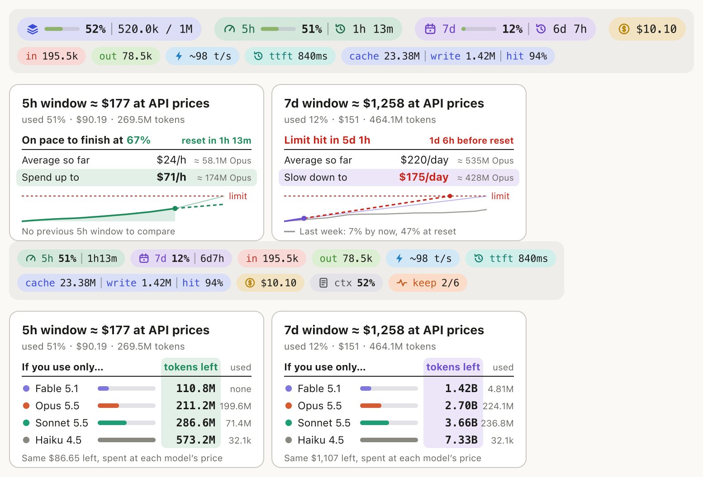
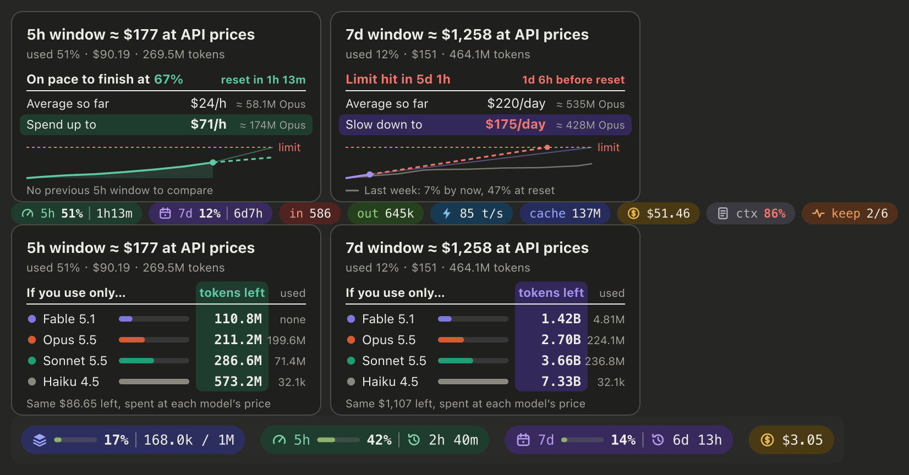

# usage-bar

Claude Code / Claude Desktop（Code 标签页）输入框上方的用量状态栏 mod：一行圆角胶囊显示 token、输出速度、缓存与费用，展开后再给出上下文、5h / 7d 限额和两张窗口卡片，并附带提示缓存保活。





> 预览图由示例数据渲染，从上到下依次是：收起时的状态栏、展开后的 Chart 卡片与胶囊行、By model 卡片。

## 功能

| 部件 | 内容 |
| --- | --- |
| 收起时的胶囊行 | `in`（未缓存输入）、`out`（输出）、输出速度 t/s、`ttft`（首字时间）、`cache`（缓存读取）、`write`（缓存写入）、`hit`（缓存命中率）、`cost`（本会话费用），后四项在同一个胶囊里 |
| 展开时的胶囊行 | 5h、7d 限额（百分比、距重置时间），加上收起时的全部内容，再加 `ctx`（上下文占用百分比）；一行排不下时自动折行 |
| Chart 卡片 | 窗口折合的 API 价额度、按当前速度外推的结论（能否撑到重置、何时触顶）、至今平均花费、剩余额度允许的花费上限、用量曲线与上一窗口的对比 |
| By model 卡片 | 剩余额度若全花在某一个模型上，各能换多少 token，以及窗口内各模型已用量 |
| 缓存保活 | 按会话单独开启；开启的会话空闲时定时发一条极短的请求读一遍已缓存的前缀，刷新提示缓存的 TTL |

百分比达到 80% 时数字变红。`📈` / `📉` 按钮展开和收起卡片，`Chart` / `By model` 切换卡片视图，`◐` 在跟随系统、浅色、深色之间切换配色。这三项显示偏好跨会话保留；保活开关不保留。

终端里没有 SVG：胶囊退化为带底色的文字，卡片退化为每个窗口一行摘要。

## 安装

需要 Claude Code 2.1.295 或更新版本（mod 所用的函数钩子 API 仍是早期访问，随版本可能变化）。

### 在另一台机器的 Claude Desktop 上安装

Claude Desktop 的 Code 标签页里不能运行 `/plugin`，所以安装要在那台机器的终端里做一次；装到 user 作用域后，Desktop 新开的会话会自动加载它。

1. 在那台机器上打开终端，启动一次 Claude Code：

   ```bash
   claude
   ```

2. 在 Claude Code 的输入框里执行：

   ```
   /plugin install usage-bar --marketplace ZeroDevi1/claude-usage-bar
   ```

   依次会看到：`Add marketplace?`，输入 `y`；插件详情，作用域保持第一项 **user**，回车；随后是保活的两个选项（见下文“配置”），不改就一路回车；最后出现 `Installed usage-bar. Plugin is now active.`。

3. 回到 Claude Desktop，在 Code 标签页**新开一个会话**，状态栏出现在输入框上方。已经打开的会话不会补加载。

也可以不进交互界面，直接用命令行安装：

```bash
claude plugin marketplace add ZeroDevi1/claude-usage-bar
```

```bash
claude plugin install usage-bar@claude-usage-bar
```

### 更新与卸载

更新要先刷新本机缓存的 marketplace，否则 `update` 看不到新版本，会一直报告“已是最新”：

```bash
claude plugin marketplace update claude-usage-bar
```

```bash
claude plugin update usage-bar@claude-usage-bar
```

卸载：

```bash
claude plugin uninstall usage-bar@claude-usage-bar
```

更新后新开会话生效。

### 从源码目录加载（开发用）

克隆仓库后，把目录写进 `~/.claude/settings.json` 的 `env`，Desktop 和终端启动的会话都会从这个目录加载：

```json
{
  "env": {
    "CLAUDE_CODE_PLUGIN_DIRS": "/绝对路径/claude-usage-bar"
  }
}
```

只在终端里临时试用：

```bash
claude --plugin-dir /绝对路径/claude-usage-bar
```

## 使用

| 操作 | 方式 |
| --- | --- |
| 展开 / 收起卡片 | 点 `📈`，或 `/usage-bar` |
| 切换卡片视图 | 点 `Chart` / `By model` |
| 切换配色 | 点 `◐` |
| 开关本会话的缓存保活 | 展开卡片后点 `Keep-alive: on/off`，或 `/usage-bar keepalive on`、`/usage-bar keepalive off` |
| 立即保活一次 | `/usage-bar ping` |

## 缓存保活

提示缓存过期后，下一条消息要按全价重新写入整个上下文。保活在会话空闲时每隔一段时间发一条极短的请求，只读已缓存的前缀，把过期时间往后推。

- **按会话开启**：每个会话默认关闭，在哪个会话里打开就只保活哪个会话，不影响其他会话，也不会带到新会话。没有全局开关。
- 它会消耗额度：每次保活按缓存读取价对整个上下文计费（Opus 5.5 下 168k 上下文约 $0.03）。
- 只在一轮对话结束后的空闲期触发；对话进行中不发。每轮空闲最多发 `keepAliveMaxPings` 次，用完即停，直到下一轮对话结束再重新计数。
- 开启后胶囊行多出 `keep 2/6`，表示本轮空闲已发 2 次、上限 6 次。
- 出现红色 `miss` 表示那次保活没有命中缓存（已经过期），这时它按全价重建了缓存，说明间隔设得太长。
- 出现 `api-error` 等字样表示请求失败，本轮空闲不再重试。

### 配置

间隔和次数上限对所有会话生效（是否保活由各会话自己决定），安装时或在 `/config` 里设置：

| 选项 | 默认 | 说明 |
| --- | --- | --- |
| `keepAliveMinutes` | `4.5` | 保活间隔（分钟）。缓存 TTL 为 5 分钟时用 4.5；订阅账号通常是 1 小时 TTL，可设为 55 |
| `keepAliveMaxPings` | `6` | 每轮空闲最多保活次数 |

## 数字是怎么来的

- 上下文、限额百分比、重置时间、费用来自引擎的 `session.measure`，与官方状态栏同源。
- `in` / `out` / `cache` / `write` 是本会话每次模型请求 usage 的累计（含子代理的请求）。
- `ttft` 是最近一次模型请求从发出到收到首个内容块（正文、思考或工具调用）的时间；速度是那次请求的输出 token 除以首个内容块到结束的时长，输出里包含思考 token，所以带 `~`。
- `hit` = 缓存读取 ÷（未缓存输入 + 缓存读取 + 缓存写入），即输入侧 token 里由缓存提供的比例。
- 卡片里的美元和 token 来自本机账本：mod 把每次请求的 token 按 10 分钟一桶记在自己的存储里，保留 8 天，本机所有会话共用，再按 `hooks/pricing.ts` 里的 API 标价折算。
- 窗口额度 = 窗口内本机花费 ÷ 已用百分比。

已知限制：

- 账本只看得到**装了这个 mod 的本机会话**。同一账号在其他设备、claude.ai 网页或未装 mod 时的用量会计入百分比但不在账本里，这时窗口额度和各项美元数会偏低。刚安装时账本是空的，卡片要等窗口内有了本机用量才有金额。
- 缓存写入按 5 分钟 TTL 的 1.25 倍输入价估算，1 小时 TTL 实际是 2 倍。
- 价格表是 2026-10 的 Anthropic 一方 API 标价，调价后需要改 `hooks/pricing.ts`。
- 自动配色跟随系统的深浅色，不跟随应用内单独设置的主题；不一致时用 `◐` 手动指定。

## 开发

```bash
claude plugin validate .
```

```bash
claude plugin test .
```

类型检查用 `tsc -p .`，它依赖引擎加载 mod 时生成的 `.claude-plugin/types/`（已忽略，不入库），所以要先用上面“从源码目录加载”的方式让引擎加载一次。

| 文件 | 职责 |
| --- | --- |
| `hooks/register.tsx` | 钩子入口：度量、记账、保活定时器、命令、绘制 |
| `hooks/ledger.ts` | 账本、用量采样、窗口汇总与节奏计算（纯函数） |
| `hooks/svg.ts` | 胶囊行与卡片的 SVG、配色表 |
| `hooks/pricing.ts` | 价格表与模型折算 |
| `hooks/format.ts` | 数字、金额、时长的写法 |
| `types/index.d.ts` | `$.state` 的类型契约 |
